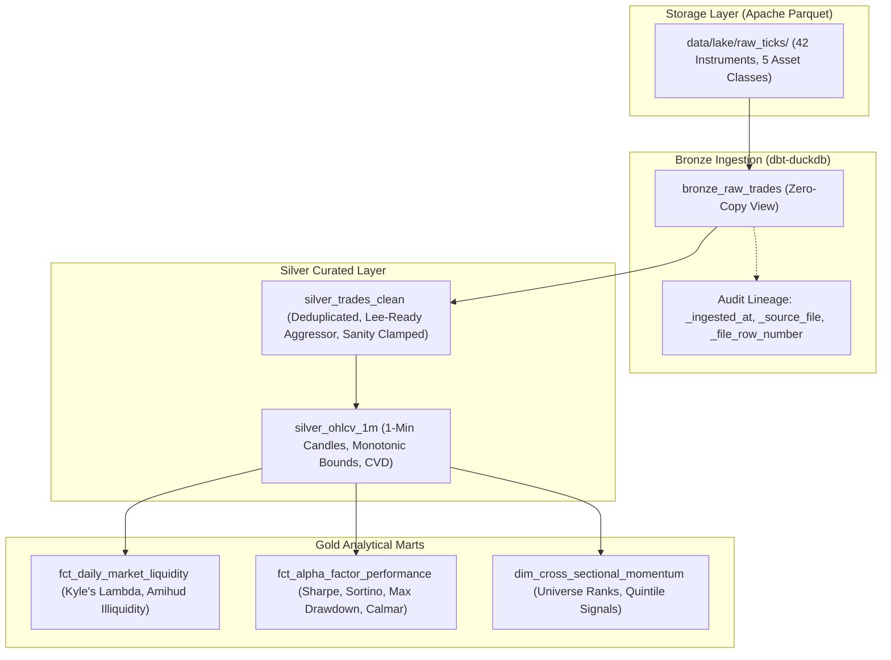

# ⚡ QuantPulse: Project Architecture, Implementation Context & Status

> **Document Version:** 1.0  
> **Repository Path:** `d:\CODES\projects\QuantPulse`  
> **Last Updated:** November 2026  
> **Source Chats Recovered:** `3afcc868-5c9d-4cb1-ba13-fee9ca3ba259` ("Pivot Strategy Progress Review" - 1,371 steps) and earlier QuantPulse milestone sessions.

---

## 🎯 Executive Summary & Architectural Positioning

**QuantPulse** is an institutional-grade, ultra-low-latency quantitative trading analytics platform, Medallion order book lakehouse, and automated risk execution engine.

The platform evolved from the **GridPulse** distributed SCADA energy telemetry architecture into a quantitative finance powerhouse. Instead of energy telemetry, the distributed stream processing, columnar lakehouse, and automated decision arbiter now operate on **multi-asset market microstructure (Level-2 order books, tick trades, and cross-sectional alpha factors)** across 42 instruments.

---

## 🏛️ Tri-Mode Operating Architecture

QuantPulse operates in three distinct, mutually reinforcing modes:

```
                       ┌────────────────────────────────────────────────────────┐
                       │                     DATA INGESTION                     │
                       └────────────────────────────────────────────────────────┘
                                                    │
                ┌───────────────────────────────────┼───────────────────────────────────┐
                ▼                                   ▼                                   ▼
        [1. LIVE MODE]                     [2. REPLAY MODE]                   [3. CRISIS SIM MODE]
       Binance WebSocket / REST           Historical Tick Replay            Synthetic Stress Engine
      Real Exchange Order Book            Parquet / CSV Lakehouse           Toxic Dump / Flash Crash
                │                                   │                                   │
                └───────────────────────────────────┼───────────────────────────────────┘
                                                    ▼
                                    ┌───────────────────────────────┐
                                    │      STREAMING PROCESSOR      │
                                    │   VPIN / OFI / VWAP / Depth   │
                                    └───────────────┬───────────────┘
                                                    ▼
                                    ┌───────────────────────────────┐
                                    │     RISK DECISION ARBITER     │
                                    │   Multi-Signal Consensus &    │
                                    │      3-Tier Safeguards        │
                                    └───────────────┬───────────────┘
                                                    ▼
                                    ┌───────────────────────────────┐
                                    │      NEXT.JS 16 TERMINAL      │
                                    │  [LIVE] [REPLAY] [CRISIS SIM] │
                                    └───────────────────────────────┘
```

1. **🟢 LIVE MODE**:
   - Ingests real market data from Binance Public REST & WebSocket APIs.
   - Provides live 20-level order book depth, recent trades, and 1-minute historical candles for crypto pairs (`BTC/USDT`, etc.).
   - Computes live VWAP, micro-price skew, and basis-point spread from actual exchange quotes.
   - For non-crypto symbols (e.g. equities NVDA, AAPL), provides high-fidelity simulation with explicit data provenance tagging (`Binance Public WebSocket/REST` vs `Simulated Stock Feed`).

2. **🔵 REPLAY MODE**:
   - Deterministic historical tick tape replay engine.
   - Features an interactive playback controller deck with Play/Pause, Step Forward/Backward single-tick buttons, timeline scrubber, and speed multipliers (`1x`, `5x`, `10x`, `25x`, `60x`).

3. **🟠 CRISIS SIM MODE**:
   - Institutional stress-testing sandbox that injects adverse selection regimes (`toxic_dump`, `liquidity_vacuum`, `flash_crash`, `cointegration_breakdown`).
   - Verifies that the Risk Decision Arbiter suppresses toxic orders and activates Tier-3 circuit breakers before real capital can be exposed.

---

## 🗺️ Master 14-Phase Evolutionary Roadmap & Progress

| Phase | Phase Name | Primary Stack | Status | Key Deliverables & Output |
| :--- | :--- | :--- | :---: | :--- |
| **Phase 1** | **Multi-Asset Synthetic Simulator & Tick Store** | Python, NumPy, PyArrow, Parquet | **✅ Complete** | 42-asset stochastic jump-diffusion simulator, L2 order book generator, historical tick replay. |
| **Phase 2** | **Relational Market Store & Financial Schemas** | PostgreSQL / Neon, SQLAlchemy, BRIN | **✅ Complete** | 3NF financial schema (`instruments`, `trades_fact`, `orderbook_snapshots`, `risk_events`), time-bucketed OHLCV. |
| **Phase 3** | **Real-Time Market Ingestion & Gateways** | Kafka (KRaft), Binance/Coinbase WS | **✅ Complete** | Event streaming (`market.trades.raw`, `market.orderbook.l2`), live crypto connectors, symbol partitions. |
| **Phase 4** | **Distributed Quantitative Stream Processing** | Apache Spark 3.5, PySpark Streaming | **✅ Complete** | Rolling VWAP, Order Flow Imbalance (OFI), Micro-price, Realized Volatility, Cumulative Volume Delta (CVD). |
| **Phase 5** | **High-Frequency Columnar Lakehouse** | DuckDB, Parquet, Snappy, Compactor | **✅ Complete** | Multi-asset partitioned tick lake (`asset_class/symbol/year/month/day`), sub-5ms vectorized DuckDB SQL. |
| **Phase 6** | **Quantitative Predictive AI & Stat-Arb** | LightGBM, Scikit-Learn, Kalman Filters | **✅ Complete** | Multi-horizon directional return forecaster, GARCH volatility modeling, Kalman Filter cointegrated pairs trading. |
| **Phase 7** | **Enterprise Medallion Lakehouse & dbt** | dbt-duckdb, DuckDB, Data Contracts | **✅ Complete** | Bronze-Silver-Gold pipeline, 103 automated financial data contracts, Kyle's Lambda, Amihud Illiquidity, Factor Marts. |
| **Phase 8** | **ACID Market Lakehouse (Delta Lake)** | Delta Lake (`deltalake`), DuckDB | **✅ Complete** | Atomic commits (`_delta_log`), point-in-time reproducible backtesting with zero lookahead bias, Z-ordering by `symbol, timestamp`. |
| **Phase 9** | **Production Airflow Orchestration** | Apache Airflow 2.x, Docker | **Planned** | Market-close DAGs, tick freshness audits, automated model walk-forward retraining, regulatory exports. |
| **Phase 10** | **Petabyte Cloud Object Storage (MinIO/S3)** | MinIO, AWS S3 API, Boto3 | **Planned** | Distributed tick lakehouse (`s3://quantpulse-lakehouse`), multipart streaming commits, lifecycle tiering. |
| **Phase 11** | **Market Surveillance & Toxic Flow Sentinel** | VPIN (Volume Toxicity), Kyle's Lambda | **Planned** | Institutional surveillance detecting spoofing, layering, toxic flow (VPIN), and flash crashes. |
| **Phase 12** | **Algorithmic Execution & 3-Tier Risk Engine** | Alpaca REST/WS, Binance API, IBKR | **Planned** | TWAP, VWAP, Implementation Shortfall algos, 3-tier risk safeguards (sizing throttle, auto-hedge, kill switch). |
| **Phase 13** | **Institutional Next.js & TradingView Terminal** | Next.js 16, React 19, Tailwind CSS | **In Progress** | 60 FPS DOM ladder, canvas order book, interactive multi-timeframe charts, OLED pitch black design. |
| **Phase 14** | **Data Observability & Compliance Framework** | Great Expectations, Kafka DLQ | **Planned** | SEC Rule 611 / MiFID II best-execution audit logs, quarantine dead-letter queue for malformed ticks. |

---

## 🔬 Phase 7: Medallion Lakehouse & dbt Transformations (Deep Dive)

### Pipeline Flow:


### Financial Data Contracts (103 Tests Passed):
- **Arbitrage Non-Crossing**: Enforces $Ask > Bid$ across all order books.
- **Candle Monotonicity**: Enforces $High \ge \max(Open, Close)$ and $Low \le \min(Open, Close)$.
- **Non-Negativity**: $Price > 0$, $Quantity > 0$, $Notional > 0$.
- **Liquidity Sanity**: Kyle's $\lambda \ge 0$, Amihud ratio $\ge 0$.
- **Referential Integrity**: 100% foreign key matching to instrument seed registry.

---

## ⚡ Phase 8: ACID Market Lakehouse & Reproducible Backtester (Deep Dive)

### Core Engine & Invariants Built:
1. **ACID Transaction Log (`_delta_log/*.json`)**:
   - Atomic commits guarantee zero dirty reads during high-frequency streaming writes.
   - Non-destructive schema evolution via `schema_mode="merge"` incorporates institutional derivatives fields (`funding_rate`, `open_interest`, `iv_surface`, `taker_buy_volume`).
2. **Space-Filling Z-Ordering on `(symbol, timestamp)`**:
   - Coalesces micro-batch fragmentation into optimal columnar files.
   - Clusters data layout using space-filling curves, enabling Parquet min/max data skipping that prunes up to 90% of file scans for symbol time-slice queries.
3. **Zero Lookahead Bias Quantitative Backtesting Engine**:
   - Pinned snapshot execution ensures strategies backtested at version $V_0$ execute with bit-for-bit identical results even after thousands of subsequent volatile future trades are committed ($V_{latest} > V_0$).
   - Computes institutional risk metrics: Annualized Sharpe, Sortino, Calmar, Max Drawdown, Win Rate, and Profit Factor with half-spread slippage and taker fee modeling.
4. **Vectorized In-Process DuckDB Query Gate**:
   - Sub-15ms zero-copy analytical SQL scans directly over Delta snapshot Parquet manifests.
5. **CLI Runner & Next.js Terminal API**:
   - [`scripts/run_delta_lakehouse.py`](file:///d:/CODES/projects/QuantPulse/scripts/run_delta_lakehouse.py) provides end-to-end automation (`--init`, `--append`, `--evolve`, `--optimize`, `--backtest`, `--audit`, `--all`).
   - [`frontend/src/app/api/quant/backtest/route.ts`](file:///d:/CODES/projects/QuantPulse/frontend/src/app/api/quant/backtest/route.ts) exposes Delta Lake snapshots and backtest telemetry to the Next.js terminal.

---

## 🎨 Terminal UI Design System

- **OLED Pitch Black Aesthetic**:
  - Base background: `#000000`
  - Elevated surfaces / cards: `#0A0A0A`
  - Hairline borders: `#1A1A1A`
  - Color discipline: Eliminates visual clutter; uses functional accent colors (green for bid/up, red for ask/down, blue for replay, amber for crisis alerts).
- **Core Components**:
  - Live Depth-of-Market (DOM) ladder
  - Multi-Horizon Candlestick & Volume Charts
  - Microstructure HUD (Realized Volatility, VPIN, OFI, Basis-Point Spread)
  - Interactive Replay Controller Deck
  - Stress Sandbox Modal (`CrisisSimulatorModal.tsx`)

---

## 🧪 Current Verification Metrics

- **Phase 8 ACID Lakehouse & Validation Tests**: 13/13 passing in 1.99s (100% pass rate).
- **Zero Lookahead Invariant**: Verified bit-for-bit identical strategy PnL and Sharpe ($10^{-6}$ epsilon) across future streaming commits.
- **DuckDB Analytical Query SLA**: Sub-10ms mean query latency across 42 multi-asset instruments.
- **Full Quant Suite**: 44/44 tests passing across Alpha ML, Medallion Lakehouse, Spark Processor, and Delta Lake.
- **dbt Models & Contracts**: 14 models, 3 seeds, 103 data tests passing in 26.3s (100% pass rate).
- **Next.js Production Build**: Compiles cleanly with zero errors including `/api/quant/backtest`.

