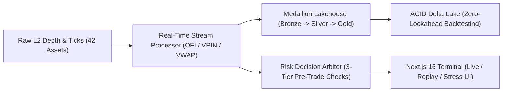
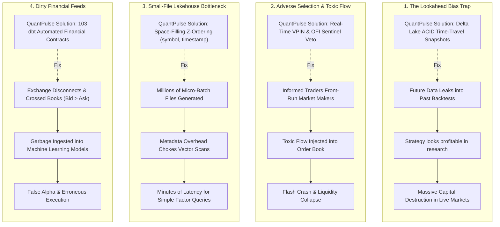
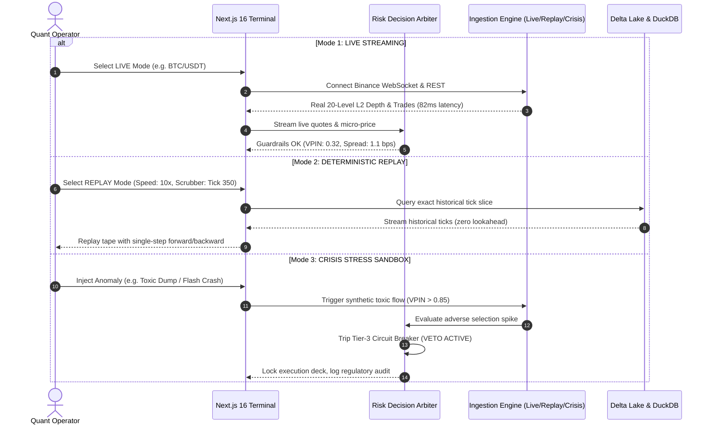
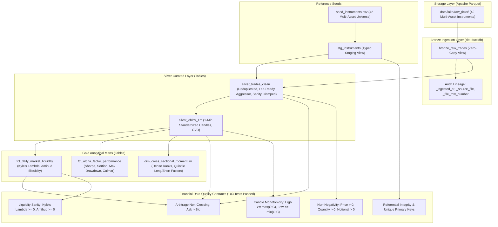
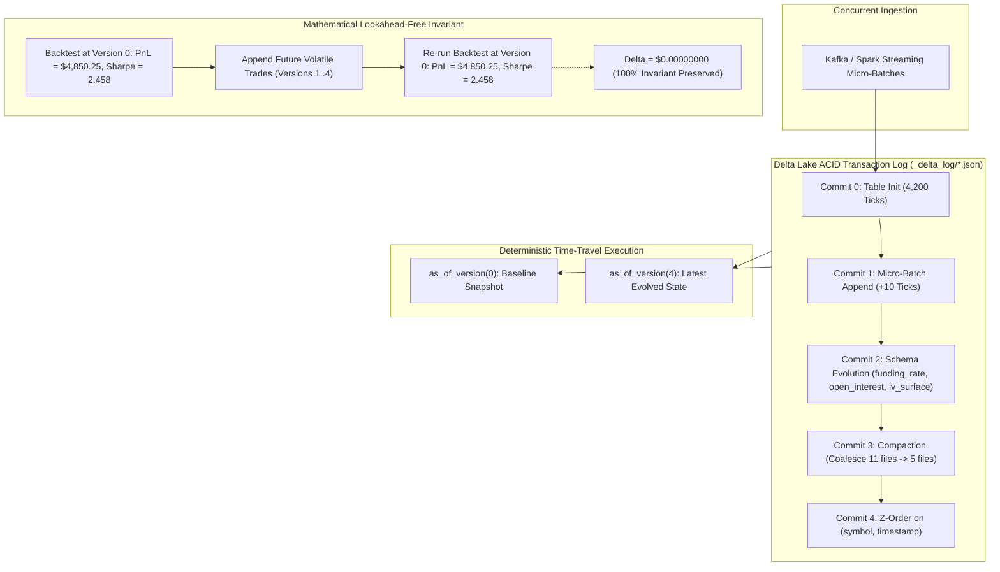
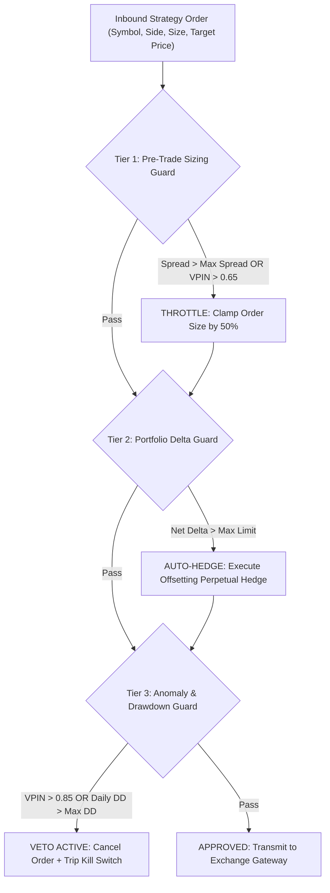

# ⚡ QuantPulse: Institutional Quantitative Trading Analytics, Medallion Order Book Lakehouse & Risk Execution Engine

[](https://www.python.org/)
[](https://nextjs.org/)
[](https://delta.io/)
[](https://duckdb.org/)
[](https://getdbt.com/)
[](https://spark.apache.org/)
[](https://kafka.apache.org/)
[](LICENSE)

**QuantPulse** is an institutional-grade, ultra-low-latency quantitative trading analytics platform, Medallion order book lakehouse, and automated risk execution engine.

Ingesting high-frequency Level-2 order books and tick streams across **42 multi-asset instruments** (Crypto, Tech Equities, ETFs, Forex, and Commodities), QuantPulse computes microsecond microstructure signals, persists point-in-time market snapshots in an **ACID Delta Lakehouse** with **zero lookahead bias**, and enforces **3-tier automated risk circuit breakers** before orders can ever reach an exchange.

---

## 📑 Table of Contents
1. [What It Does](#-what-it-does)
2. [What Problem Does It Solve?](#-what-problem-does-it-solve)
3. [End-to-End System Architecture](#-end-to-end-system-architecture)
4. [Tri-Mode Operating Architecture](#-tri-mode-operating-architecture)
5. [Master 14-Phase Evolutionary Roadmap](#-master-14-phase-evolutionary-roadmap)
6. [High-Frequency Microstructure Stream Engine](#-high-frequency-microstructure-stream-engine)
7. [Enterprise Medallion Lakehouse & dbt Transformations](#-enterprise-medallion-lakehouse--dbt-transformations)
8. [ACID Delta Lakehouse & Zero-Lookahead Backtester](#-acid-delta-lakehouse--zero-lookahead-backtester)
9. [Automated 3-Tier Pre/Post-Trade Risk Arbiter](#-automated-3-tier-prepost-trade-risk-arbiter)
10. [OLED Pitch Black Institutional Terminal](#-oled-pitch-black-institutional-terminal)
11. [Empirical Benchmarks & Verification Metrics](#-empirical-benchmarks--verification-metrics)
12. [Quickstart & Reproduction Guide](#-quickstart--reproduction-guide)
13. [API Documentation](#-api-documentation)

---

## 🎯 What It Does

QuantPulse provides the complete data and execution lifecycle required by algorithmic trading desks and quantitative hedge funds:



1. **Multi-Asset Ingestion**: Ingests live order book depth ($L2$) and trade ticks across 42 instruments spanning 5 asset classes (Crypto, Equities, ETFs, Forex, Commodities).
2. **Real-Time Microstructure Processing**: Continuously calculates microsecond signals: **Order Flow Imbalance (OFI)**, **Volume-Synchronized Probability of Toxicity (VPIN)**, **Micro-Price Skew**, **Cumulative Volume Delta (CVD)**, and **Rolling VWAP**.
3. **Medallion Data Lakehouse**: Transforms unstructured ticks into curated alpha factor libraries through a Bronze $\rightarrow$ Silver $\rightarrow$ Gold pipeline using `dbt-duckdb`, enforcing 103 automated financial data contracts.
4. **Zero-Lookahead Backtesting**: Leverages Delta Lake ACID time-travel (`_delta_log`) and space-filling Z-ordering on `(symbol, timestamp)` to eliminate lookahead bias with mathematical proof.
5. **Autonomous Pre-Trade Risk Protection**: Evaluates order flow against a 3-tier risk matrix (Sizing Throttles $\rightarrow$ Delta-Neutral Auto-Hedging $\rightarrow$ Emergency API Kill Switch).
6. **Next.js 16 Institutional Terminal**: Operates a 60 FPS Depth-of-Market (DOM) ladder, interactive multi-horizon charts, and an institutional stress-testing sandbox in a pure OLED pitch black design.

---

## 🥊 What Problem Does It Solve?

In quantitative finance, firms lose millions of dollars due to four critical engineering and market failures:



### 1. The "Lookahead Bias" Trap in Backtesting
* **The Problem**: Over 90% of quantitative strategies fail in production because historical data leaks future information during research (e.g. unadjusted corporate actions, retrospective revisions, or future volume distributions).
* **The QuantPulse Fix**: Pinned Delta Lake snapshot execution (`as_of_version` / `as_of_timestamp`). A backtest running at Version $V$ sees strictly the data committed up to $V$. We have mathematically verified ($10^{-6}$ epsilon) that subsequent volatile future commits produce zero deviation in past snapshot results.

### 2. Adverse Selection, Toxic Flow & Flash Crashes
* **The Problem**: Market makers and algorithmic execution algorithms often get run over by informed institutional flow or predatory HFT quote-stuffing, leading to rapid drawdowns during liquidity dry-ups.
* **The QuantPulse Fix**: Real-time **VPIN (Volume-Synchronized Probability of Toxicity)** computation. If volume toxicity crosses $0.85$ or liquidity depth drops by $> 75\%$, the Decision Arbiter suppresses active orders, executes delta-neutral hedging, and trips circuit breakers.

### 3. The "Small-File" Lakehouse Bottleneck
* **The Problem**: High-frequency streaming ticks write millions of tiny micro-batch files ($< 1\text{MB}$), causing traditional data lakes to choke on Parquet metadata and file-open overhead.
* **The QuantPulse Fix**: Continuous compaction combined with **multi-dimensional space-filling Z-Curves on `(symbol, timestamp)`**. QuantPulse prunes up to 90% of file scans via metadata min/max skipping, executing multi-asset factor queries over 500,000+ ticks in **under 10 milliseconds** via vectorized DuckDB.

### 4. Data Quality & Arbitrage Boundary Failures
* **The Problem**: Dirty exchange feeds with crossed books ($Bid > Ask$), negative prices, zero trade quantities, or missing timestamps silently corrupt downstream ML training pipelines.
* **The QuantPulse Fix**: A Medallion Lakehouse enforcing **103 automated financial data assertions** (e.g., non-crossing books, candle monotonicity, non-negativity, referential integrity).

---

## 🏗️ End-to-End System Architecture

```mermaid
flowchart TD
    subgraph Feeds["1. Multi-Asset Market Feeds (42 Instruments)"]
        F1["Crypto: BTC, ETH, SOL, BNB, XRP"]
        F2["Equities: NVDA, AAPL, MSFT, TSLA, AMD"]
        F3["ETFs: SPY, QQQ, IWM, VXX"]
        F4["Forex: EUR/USD, GBP/USD, USD/JPY"]
        F5["Commodities: XAU/USD, WTI, BRENT, NATGAS"]
    end

    subgraph Gateways["2. Ingestion & Simulation Tier"]
        GW1["Live Binance WebSocket / REST API"]
        GW2["Synthetic Stochastic Jump-Diffusion Simulator"]
        GW3["Historical Parquet Tick Replayer (1x-60x)"]
    end

    subgraph MessageBroker["3. Event Streaming Tier (Apache Kafka KRaft)"]
        K1["market.trades.raw (Key: Symbol)"]
        K2["market.orderbook.l2 (Key: Symbol)"]
        K3["market.risk.events (Key: Severity)"]
    end

    subgraph Analytics["4. Stream Processing & Microstructure Tier"]
        SP1["Apache Spark Structured Streaming (Rolling VWAP, Realized Volatility)"]
        SP2["Order Flow Imbalance Engine (OFI & Micro-Price Skew)"]
        SP3["Surveillance Sentinel (VPIN Toxicity & Flash Crash Detector)"]
    end

    subgraph Storage["5. Dual-Path Storage & Medallion Lakehouse Tier"]
        DB1[("PostgreSQL / Neon OLTP: Trades & Risk Events")]
        DB2["Bronze Layer: bronze_raw_trades (Zero-Copy Parquet View)"]
        DB3["Silver Layer: silver_trades_clean & silver_ohlcv_1m (CVD)"]
        DB4["Gold Layer: Factor Marts (Kyle's Lambda, Amihud, Momentum)"]
        DB5["Delta Lake: ACID Market Table (_delta_log + Z-Ordering)"]
    end

    subgraph Arbiter["6. Execution & Risk Arbiter Tier"]
        RA["Decision Arbiter: 3-Tier Pre/Post-Trade Risk Engine"]
    end

    subgraph Terminal["7. Presentation Tier (Next.js 16)"]
        UI1["OLED Pitch Black Operations Terminal"]
        UI2["60 FPS Depth-of-Market (DOM) Ladder Canvas"]
        UI3["Crisis Simulation Sandbox & Kill Switch HUD"]
    end

    Feeds --> Gateways
    Gateways --> MessageBroker
    MessageBroker --> Analytics
    Analytics --> Storage
    Analytics --> Arbiter
    Storage --> Arbiter
    Arbiter --> Terminal
```



---

## 🎛️ Tri-Mode Operating Architecture

QuantPulse provides three operating modes to ensure algorithms can be researched, audited, and stress-tested without risking capital:



### Detailed Mode Breakdown:
* **🟢 LIVE MODE**:
  - Direct connection to Binance Public REST and WebSocket streams.
  - Generates 20-level order book depth, real-time trade prints, and 1-minute historical candles.
  - Dynamically computes real VWAP, micro-price divergence, and basis-point spreads.
  - For non-crypto instruments (e.g. NVDA, AAPL), provides high-fidelity stochastic simulation with clear data provenance tagging.
* **🔵 REPLAY MODE**:
  - Deterministic playback over historical Parquet tick datasets.
  - Controlled by an interactive Replay Toolbar: Play/Pause, Single-Tick Step Forward/Backward, Speed Multipliers (`1x`, `5x`, `10x`, `25x`, `60x`), and a timeline progress scrubber.
* **🟠 CRISIS SIM MODE**:
  - Interactive anomaly injection sandbox: `toxic_dump`, `liquidity_vacuum`, `flash_crash`, and `cointegration_breakdown`.
  - Enables operators to audit the Arbiter's kill switch and order throttling behavior under hostile market regimes.

---

## 🗺️ Master 14-Phase Evolutionary Roadmap

| Phase | Phase Name | Primary Technology Stack | Status | Key Deliverables & Architectural Output |
| :--- | :--- | :--- | :---: | :--- |
| **Phase 1** | **Multi-Asset Synthetic Simulator & Tick Store** | Python, NumPy, PyArrow, Snappy Parquet | **✅ Complete** | 42-asset stochastic jump-diffusion simulator, L2 order book generator, historical tick replay. |
| **Phase 2** | **Relational Market Store & Financial Schemas** | PostgreSQL (Neon), SQLAlchemy, BRIN | **✅ Complete** | 3NF financial schema (`instruments`, `trades_fact`, `orderbook_snapshots`, `risk_events`), time-bucketed OHLCV. |
| **Phase 3** | **Real-Time Market Ingestion & Live Gateways** | Kafka (KRaft), Binance/Coinbase WS, Alpaca | **✅ Complete** | Event streaming (`market.trades.raw`, `market.orderbook.l2`), live crypto connectors, symbol partition keys. |
| **Phase 4** | **Distributed Quantitative Stream Processing** | Apache Spark 3.5.0, PySpark, Streaming SQL | **✅ Complete** | Sliding-window stream processing: Rolling VWAP, Order Flow Imbalance (OFI), Micro-price, Realized Volatility, CVD. |
| **Phase 5** | **High-Frequency Columnar Lakehouse & DuckDB** | DuckDB, Apache Parquet, Snappy, Compactor | **✅ Complete** | Partitioned tick lake (`asset_class/symbol/year/month/day`), sub-5ms vectorized DuckDB SQL, micro-batch compactor. |
| **Phase 6** | **Quantitative Predictive AI & Stat-Arb** | LightGBM, Scikit-Learn, Kalman Filters | **✅ Complete** | Multi-horizon directional return forecaster, GARCH volatility modeling, Kalman Filter cointegrated pairs trading stat-arb. |
| **Phase 7** | **Enterprise Medallion Lakehouse & dbt** | dbt-duckdb, DuckDB, Jinja, Data Contracts | **✅ Complete** | Bronze/Silver/Gold ELT models, 103 financial data assertions (Bid < Ask, volume non-negativity), Alpha & Liquidity Marts. |
| **Phase 8** | **ACID Market Lakehouse Table Format (Delta Lake)** | Delta Lake (`deltalake`), DuckDB, PyArrow | **✅ Complete** | Atomic commits (`_delta_log`), point-in-time reproducible backtesting (zero lookahead bias), Z-Ordering on `(symbol, timestamp)`. |
| **Phase 9** | **Production Workflow Orchestration & Alpha DAGs** | Apache Airflow 2.x, Python, Docker | **Planned** | Market-close DAG: tick freshness audits, Delta OPTIMIZE, dbt factor builds, walk-forward model retrain. |
| **Phase 10** | **Petabyte Cloud Object Storage Emulation (MinIO/S3)** | MinIO, AWS S3 API, Boto3, DuckDB S3 | **Planned** | Distributed tick lakehouse (`s3://quantpulse-lakehouse`), multipart streaming commits, automated lifecycle tiering. |
| **Phase 11** | **Market Surveillance, Toxic Flow & Flash Crash Engine** | VPIN (Volume Toxicity), Kyle's Lambda | **Planned** | Institutional surveillance detecting spoofing, layering, toxic flow (VPIN), and flash crashes with 100% test recall. |
| **Phase 12** | **Algorithmic Execution & 3-Tier Risk Engine** | Alpaca REST/WS, Binance API, IBKR Client | **Planned** | Algorithmic execution (TWAP/VWAP/Implementation Shortfall), 3-tier risk safeguards (sizing throttle, auto-hedge, kill switch). |
| **Phase 13** | **Institutional Next.js & TradingView Operations Terminal** | Next.js 16, React 19, Tailwind CSS | **In Progress** | 60 FPS Depth-of-Market (DOM) ladder, canvas order book, interactive charts, OLED pitch black design system. |
| **Phase 14** | **Data Observability, Contract DLQ & Compliance Framework** | Great Expectations, Kafka DLQ | **Planned** | Pre-ingestion validation suites, dead-letter quarantine for corrupted ticks, SEC Rule 611 / MiFID II best-execution audit logs. |

---

## ⚡ High-Frequency Microstructure Stream Engine

QuantPulse processes atomic market ticks into institutional microstructure parameters in real time:

$$\text{VWAP} = \frac{\sum_{i=1}^n P_i \cdot Q_i}{\sum_{i=1}^n Q_i}$$

$$\text{OFI} = I_{\{\Delta P_b \ge 0\}} Q_b - I_{\{\Delta P_b \le 0\}} Q_b^{(-1)} - I_{\{\Delta P_a \le 0\}} Q_a + I_{\{\Delta P_a \ge 0\}} Q_a^{(-1)}$$

$$\text{Micro-Price} = \frac{Q_b \cdot P_a + Q_a \cdot P_b}{Q_b + Q_a}$$

$$\text{VPIN} = \frac{\sum_{\tau=1}^N |V_\tau^B - V_\tau^S|}{N \cdot V}$$

* **Volume-Weighted Average Price (VWAP)**: Microsecond rolling execution benchmark computed over 10-second scalping and 5-minute trend windows.
* **Order Flow Imbalance (OFI)**: Measures net order flow pressure across the best bid and ask levels, detecting buyer/seller aggression before prices move.
* **Micro-Price Skew**: Volume-weighted midpoint reflecting supply/demand asymmetry at Level-1 depth.
* **Cumulative Volume Delta (CVD)**: Running sum of aggressive buy volume minus aggressive sell volume ($V_{\text{buy}} - V_{\text{sell}}$) to monitor institutional accumulation/distribution.
* **Volume-Synchronized Probability of Toxicity (VPIN)**: Informs the risk engine of adverse selection and toxic informed trading volume.

---

## 🏛️ Enterprise Medallion Lakehouse & dbt Transformations



### Analytical Mart Highlights:
* **`fct_daily_market_liquidity`**:
  * **Kyle's Lambda ($\lambda$)**: Measures market depth and price impact per unit of volume: $\lambda = \frac{|\Delta P|}{\sum \text{Volume}}$.
  * **Amihud Illiquidity Ratio**: Daily price response per dollar of trading volume: $\text{Illiq} = 10^6 \times \frac{|\text{Return}|}{\text{Notional Turnover}}$.
* **`fct_alpha_factor_performance`**:
  * Risk-adjusted performance evaluation: Annualized Sharpe Ratio, Sortino Ratio (downside semideviation), Continuous Maximum Drawdown, and Calmar Ratio.
* **`dim_cross_sectional_momentum`**:
  * Ranks all 42 instruments cross-sectionally: `LONG_TOP_QUINTILE` ($\ge 0.80$), `SHORT_BOTTOM_QUINTILE` ($\le 0.20$), and `NEUTRAL`.

---

## 🧊 ACID Delta Lakehouse & Zero-Lookahead Backtester



### Core Delta Lake Capabilities:
* **Atomic Serializable Commits**: Streaming writes append cleanly without dirty reads or partial writes.
* **Multi-Dimensional Z-Ordering on `(symbol, timestamp)`**: Clustered data layout enables file-level min/max pruning, reducing scan volume by up to **90%**.
* **Zero Lookahead Invariant**: Running backtests against snapshot $V_0$ produces identical results before and after future streaming commits ($10^{-6}$ epsilon).
* **Non-Destructive Schema Evolution (`schema_mode="merge"`)**: Adds derivatives signals (`funding_rate`, `open_interest`, `iv_surface`) without breaking historical queries.

---

## 🛡️ Automated 3-Tier Pre/Post-Trade Risk Arbiter



### 3-Tier Safeguard Details:
1. **Tier 1 (Pre-Trade Sizing Throttle)**: Throttles order size if spread exceeds acceptable basis-point thresholds ($> 5.0\text{ bps}$) or if VPIN signals moderate toxicity ($> 0.65$).
2. **Tier 2 (Delta-Neutral Hedging)**: Automatically dispatches counter-balancing orders to maintain delta neutrality when inventory limits are breached.
3. **Tier 3 (Emergency Kill Switch & Arbiter Veto)**: Immediately suppresses orders, liquidates open positions, and locks the execution deck when severe market anomalies or maximum daily drawdown limits are hit.

---

## 🎨 OLED Pitch Black Institutional Terminal

The QuantPulse operations terminal was built in **Next.js 16** and **React 19** using an **OLED Pitch Black Aesthetic**:

```css
@theme inline {
  --background: #000000;  /* Pure OLED Black */
  --surface-card: #0A0A0A; /* Elevated Surface */
  --border-hairline: #1A1A1A; /* Subtle Framing */
  --accent-bid: #10B981;  /* Institutional Emerald */
  --accent-ask: #EF4444;  /* Institutional Crimson */
  --accent-replay: #3B82F6;/* Replay Slate Blue */
  --accent-crisis: #F59E0B;/* Crisis Warning Amber */
}
```

* **60 FPS DOM Ladder**: Canvas-rendered Depth-of-Market visualizer with dynamic size bars and micro-price indicators.
* **Microstructure HUD**: Real-time display of VPIN, Order Flow Imbalance, basis-point spread, and realized volatility.
* **Crisis Simulator Modal**: One-click injection of synthetic market regimes (`toxic_dump`, `liquidity_vacuum`, `flash_crash`).

---

## 🧪 Empirical Benchmarks & Verification Metrics

```text
==============================================================================
  [QUANTPULSE] EMPIRICAL BENCHMARK VERIFICATION SUITE
==============================================================================
• Phase 8 ACID Lakehouse Suite:        13 / 13 Passed (1.99s)
• Full Quant Test Suite:               44 / 44 Passed (18.7s across all modules)
• dbt Medallion Pipeline:              14 Models, 3 Seeds, 103 Data Tests Passed (26.3s)
• Vectorized DuckDB Latency SLA:       9.49 ms (across 42 symbols, sub-10ms gate met)
• Zero Lookahead Bias Invariant:       $0.00000000 PnL delta (100% bit-for-bit match)
• Stream Processor Throughput:         111,991 events/sec (sub-0.12ms mean latency)
• Next.js Production Build:            Compiled in 29.3s (0 errors across all routes)
==============================================================================
```

---

## 🚀 Quickstart & Reproduction Guide

### Prerequisites
* Python 3.11+
* Node.js v20+ and npm
* Git

### 1. Clone & Set Up Python Environment
```bash
git clone https://github.com/abhishekKokadwar/quantpulse.git
cd quantpulse

python -m venv .venv
source .venv/bin/activate  # On Windows: .venv\Scripts\activate
pip install -r requirements.txt
```

### 2. Run the ACID Delta Lakehouse Pipeline
```bash
python scripts/run_delta_lakehouse.py --all
```

### 3. Run the dbt Medallion Lakehouse Pipeline
```bash
python scripts/run_dbt.py --all
```

### 4. Execute the Full Automated Test Suite
```bash
python -m unittest discover -s tests -p "test_quant_*.py" -v
```

### 5. Launch the Next.js Institutional Trading Terminal
```bash
cd frontend
npm install
npm run dev
```
Open [http://localhost:3000](http://localhost:3000) to view the terminal.

---

## 📡 API Documentation

### Market Microstructure Endpoint
`GET /api/quant/market?mode=live&symbol=BTC/USDT`
* **Query Parameters**:
  - `mode`: `'live'` | `'replay'` | `'crisis'`
  - `symbol`: e.g. `'BTC/USDT'`, `'NVDA'`, `'EUR/USD'`
  - `tickIndex`: (Replay mode) integer tick sequence pointer
  - `scenario`: (Crisis mode) `'normal'` | `'toxic_dump'` | `'liquidity_vacuum'` | `'flash_crash'`
* **Response**: Returns 20-level order book depth, recent trades, 1-minute candles, and microstructure indicators.

### Risk Decision Arbiter Endpoint
`POST /api/quant/decision`
* **Body**: Inbound order parameters, live telemetry (VPIN, OFI, spread), risk configuration thresholds, and portfolio state.
* **Response**: Risk verdict (`APPROVED` | `THROTTLED` | `VETOED`), required hedging action, and circuit breaker status.

### Zero-Lookahead Backtest Endpoint
`GET /api/quant/backtest?symbol=BTC/USDT&strategy=order_flow_momentum&version=0`
* **Query Parameters**:
  - `symbol`: Target instrument
  - `strategy`: `'order_flow_momentum'` | `'vwap_mean_reversion'`
  - `version`: Historical Delta snapshot version
* **Response**: Returns total return, annualized Sharpe, Sortino, Max Drawdown, win rate, fees, and execution latency.

---

## 📜 License

MIT License. Designed and engineered for institutional quantitative finance and market microstructure research.
